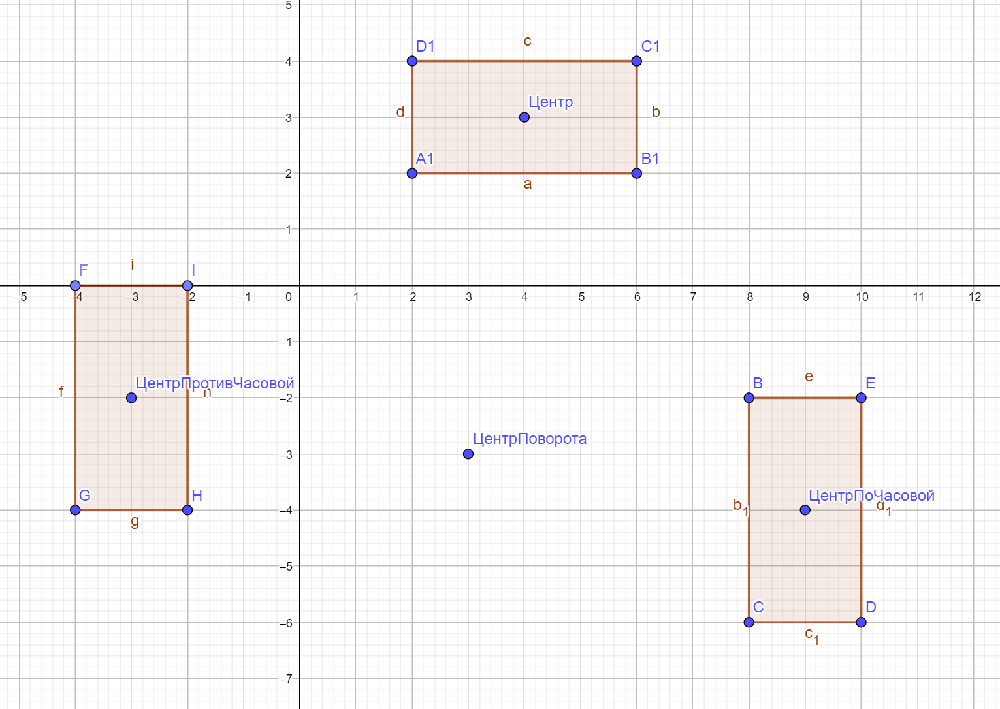

# Фигуры (Figures)

Учебный проект на Kotlin: абстрактный класс `Figure`, интерфейсы `Movable` и `Transforming`,
три реализации фигур — `Rect`, `Circle`, `Square` — с поддержкой перемещения, масштабирования
и поворота на 90°.

## Структура проекта

```
src/
├── Figure.kt        — абстрактный базовый класс (id + абстрактный area())
├── Movable.kt       — интерфейс перемещения move(dx, dy)
├── Transforming.kt  — интерфейс resize(zoom) и rotate(direction, centerX, centerY)
├── Rect.kt          — прямоугольник
├── Circle.kt        — окружность
├── Square.kt        — квадрат
└── Main.kt          — демонстрация работы
figury.png           — иллюстрация к повороту
```

## Наследование и интерфейсы

`Figure` — абстрактный класс, у него есть поле `id` и абстрактный метод `area()`:

```kotlin
abstract class Figure(val id: Int) {
    abstract fun area(): Float
}
```

Каждая фигура наследует `Figure` и реализует интерфейсы:

```kotlin
class Rect(var x: Int, var y: Int, var width: Int, var height: Int, id: Int = 0) :
    Movable, Transforming, Figure(id)

class Circle(var x: Int, var y: Int, var radius: Int, id: Int = 0) :
    Movable, Transforming, Figure(id)

class Square(var x: Int, var y: Int, var side: Int, id: Int = 0) :
    Movable, Transforming, Figure(id)
```

| Класс  | `Movable.move` | `Transforming.resize` | `Transforming.rotate` | `Figure.area` |
|--------|----------------|------------------------|-----------------------|---------------|
| Rect   | сдвиг `x`, `y` | `width`, `height` × zoom | поворот 4 углов, обмен сторон | `w * h` |
| Circle | сдвиг `x`, `y` | `radius` × zoom | поворот центра окружности | `π * r²` |
| Square | сдвиг `x`, `y` | `side` × zoom | поворот 4 углов, сторона не меняется | `side²` |

## Поворот на 90°

Фигура поворачивается вокруг произвольной точки `(centerX, centerY)`. Формулы (ось Y направлена
вверх, как на рисунке):

* по часовой стрелке: `(dx, dy) → (dy, -dx)`
* против часовой стрелки: `(dx, dy) → (-dy, dx)`

где `dx = x - centerX`, `dy = y - centerY`.

Общая функция лежит в `Transforming.kt`:

```kotlin
fun rotatePoint(x: Int, y: Int, direction: RotateDirection, centerX: Int, centerY: Int): Pair<Int, Int> {
    val dx = x - centerX
    val dy = y - centerY
    return when (direction) {
        RotateDirection.Clockwise -> Pair(centerX + dy, centerY - dx)
        RotateDirection.CounterClockwise -> Pair(centerX - dy, centerY + dx)
    }
}
```

Прямоугольник поворачивается через все четыре угла: по ним вычисляется новая граница, при этом
ширина и высота меняются местами. Масштабирование не двигает позицию фигуры (`x`, `y` остаются
на месте), меняются только размеры — пропорции сохраняются.

## Демонстрация работы

Иллюстрация к повороту (исходный прямоугольник `A1B1C1D1`, центр поворота `(3, -3)`,
результаты `BCDE` — по часовой, `FGHI` — против часовой):



Вывод программы `Main.kt`:

```text
1) Исходные фигуры
   Rect(id=1, x=2, y=2, w=4, h=2, area=8.0)
   Square(id=2, x=-4, y=-4, side=3, area=9.0)
   Circle(id=3, center=(5, 5), r=3, area=28.274334)

2) Перемещение move(3, -2)
   Rect(id=1, x=5, y=0, w=4, h=2, area=8.0)
   Square(id=2, x=-1, y=-6, side=3, area=9.0)
   Circle(id=3, center=(8, 3), r=3, area=28.274334)

3) Масштабирование resize(2)
   Rect(id=1, x=5, y=0, w=8, h=4, area=32.0)
   Square(id=2, x=-1, y=-6, side=6, area=36.0)
   Circle(id=3, center=(8, 3), r=6, area=113.097336)

4) Поворот по часовой стрелке вокруг точки (0, 0)
   Rect(id=1, x=0, y=-13, w=4, h=8, area=32.0)
   Square(id=2, x=-6, y=-5, side=6, area=36.0)
   Circle(id=3, center=(3, -8), r=6, area=113.097336)

5) Поворот против часовой стрелки вокруг точки (0, 0) - возврат к шагу 3
   Rect(id=1, x=5, y=0, w=8, h=4, area=32.0)
   Square(id=2, x=-1, y=-6, side=6, area=36.0)
   Circle(id=3, center=(8, 3), r=6, area=113.097336)

6) Поворот прямоугольника вокруг точки (3, -3) - как на рисунке figury.png
   исходный:  Rect(id=0, x=2, y=2, w=4, h=2, area=8.0)
   CW:        Rect(id=0, x=8, y=-6, w=2, h=4, area=8.0)
   CCW:       Rect(id=0, x=2, y=2, w=4, h=2, area=8.0)

7) Площади фигур (метод абстрактного класса Figure)
   Rect: area() = 32.0
   Square: area() = 36.0
   Circle: area() = 113.097336
```

Что здесь проверяется:

* **перемещение** — все фигуры сместились на `(3, -2)`, размеры не изменились;
* **масштабирование** — размеры удвоились, координаты `x`/`y` остались прежними;
* **поворот** — шаги 4 и 5 взаимно обратны: `rotate(Clockwise)` затем `rotate(CounterClockwise)`
  возвращает фигуру в исходное положение;
* шаг 6 повторяет рисунок `figury.png`: прямоугольник `4×2` с углами `(2,2)…(6,4)` вокруг точки
  `(3, -3)` по часовой стрелке переходит в `(8,-6)…(10,-2)` (уже `2×4`), а против часовой — в
  `(-4,-4)…(-2,0)`.

## Как запустить

Через IntelliJ IDEA: открыть проект и запустить `Main.kt` (кнопка слева от `fun main`).

Или из командной строки, если установлен Kotlin:

```bash
kotlinc src/*.kt -include-runtime -d figures.jar
java -jar figures.jar
```

Или одним файлом:

```bash
kotlinc src/*.kt -d out
kotlin -cp out MainKt
```
